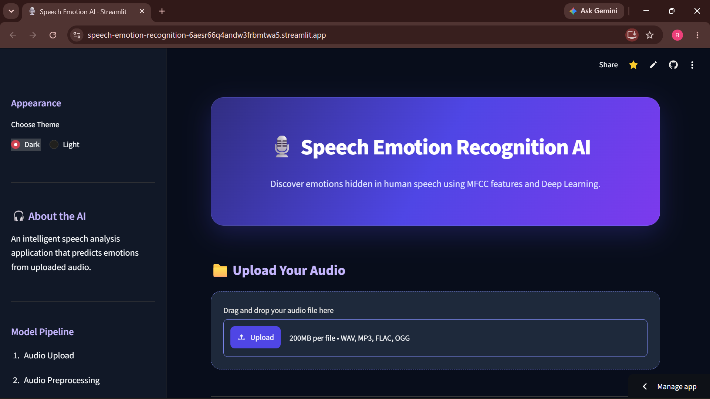

# 🎙️ Speech Emotion Recognition Using MFCC and CNN-BiLSTM-Attention

An individual major project developed as part of a Machine Learning Internship.

This project develops a deep learning system that recognizes human emotions from speech audio using **MFCC features and a CNN-BiLSTM-Attention architecture**.

## 🚀 Live Demo

The project includes a Streamlit frontend and a FastAPI backend.

- **Frontend:** Streamlit
- **Backend:** FastAPI
- **Deployment:** Streamlit Community Cloud and Render


## 📸 Application Screenshots

### 🏠 Homepage



### 🎧 Emotion Prediction

**Audio Upload**


**Prediction Result**


**Emotion Analysis**


**Detailed Emotion Scores**


**Audio Analysis Process**


**Analysis Information**


## 🎯 Project Objectives

- Extract meaningful acoustic features from speech using MFCC.
- Recognize eight different emotions from audio recordings.
- Develop a CNN-BiLSTM-Attention deep learning model.
- Compare the deep learning model with an RBF-SVM baseline.
- Evaluate performance using accuracy, Macro F1-score, and Weighted F1-score.
- Provide an interface for users to upload audio and view emotion predictions.

## 😊 Emotions Recognized

The system classifies speech into eight emotion categories:

1. Neutral
2. Calm
3. Happy
4. Sad
5. Angry
6. Fearful
7. Disgust
8. Surprised

## 🧠 Model Architecture

**CNN → BiLSTM → Temporal Attention → Classification**

The project uses:

- **MFCC:** Extracts speech characteristics.
- **Delta and Delta-Delta:** Capture changes in acoustic features.
- **CNN:** Learns local patterns from extracted features.
- **BiLSTM:** Learns sequential information in both directions.
- **Attention:** Focuses on important time steps.
- **Dense Classification:** Predicts the emotion category.

Each three-second audio clip is represented using 120 features across 130 time frames.

## 📊 Dataset

**RAVDESS — Ryerson Audio-Visual Database of Emotional Speech and Song**

- 1,440 speech recordings.
- 24 actors.
- 8 emotion categories.
- Speaker-independent training, validation, and testing.

The dataset is distributed under the CC BY-NC-SA 4.0 license.

## 📈 Model Evaluation Results

The selected final model is Experiment 3, chosen based on validation Macro F1-score.

| Metric | Result |
|---|---:|
| Validation Macro F1 | 0.5161 |
| Test Accuracy | 56.67% |
| Test Macro F1 | 0.5307 |
| Test Weighted F1 | 0.5384 |

### Model Comparison

| Model | Test Accuracy | Test Macro F1 |
|---|---:|---:|
| Experiment 1 | 47.08% | 0.4292 |
| Experiment 2 | 53.75% | 0.5231 |
| **Experiment 3 (Selected)** | **56.67%** | **0.5307** |
| Experiment 4 | 50.00% | 0.4783 |
| RBF-SVM Baseline | 46.67% | 0.4464 |

These results are from the held-out test set containing 240 clips from actors 21–24.

## 🛠️ Technologies Used

- Python
- TensorFlow / Keras
- Librosa
- Scikit-learn
- NumPy
- Pandas
- Matplotlib
- Plotly
- Streamlit
- FastAPI
- Uvicorn
- Git and GitHub

## 📁 Project Structure

```text
Speech-Emotion-Recognition/
│
├── Source_Code/
│   ├── backend/
│   ├── frontend/
│   ├── models/
│   ├── results/
│   ├── ser/
│   ├── tests/
│   ├── docs/
│   ├── requirements.txt
│   ├── run_pipeline.py
│   ├── predict.py
│   ├── build_report.py
│   └── build_ppt.py
│
├── Speech_Emotion_Recognition_Report.pdf
└── Speech_Emotion_Recognition_Presentation.pptx
```

## ⚙️ Installation and Execution

### 1. Clone the Repository

```bash
git clone https://github.com/roniarosariosamk/Speech-Emotion-Recognition.git
cd Speech-Emotion-Recognition
```

### 2. Navigate to Source Code

```bash
cd Speech-Emotion-Recognition/Source_Code
```

### 3. Create a Virtual Environment

```bash
python -m venv .venv
```

Activate it in Windows PowerShell:

```powershell
.\.venv\Scripts\Activate.ps1
```

### 4. Install Dependencies

```bash
pip install -r requirements.txt
```

### 5. Run the Prediction Script

```bash
python predict.py path\to\audio.wav
```

### 6. Run Automated Tests

```bash
python -m pytest -q
```

For complete training, evaluation, backend, and frontend instructions, refer to the README inside `Speech-Emotion-Recognition/Source_Code/`.

## 📄 Project Documentation

The repository includes:

- `Speech_Emotion_Recognition_Report.pdf` — Detailed project report.
- `Speech_Emotion_Recognition_Presentation.pptx` — Project presentation.
- `Source_Code/docs/` — Additional technical documentation.

## ⚠️ Limitations

- The model is trained on acted emotional speech from the RAVDESS dataset.
- The test set contains only four actors.
- Sad and fearful emotions have comparatively lower recognition performance.
- Neutral emotion is sometimes over-predicted.
- Cross-dataset and noise-robustness evaluations have not been performed.
- Reported test performance may be somewhat optimistic because test results were also examined during comparisons of the experiments.

This project is a research prototype and should not be considered a general-purpose emotion detector.

## 👩‍💻 Author

**Ronia Rosario Sam K**

Machine Learning Project — Speech Emotion Recognition

---

⭐ If you find this project interesting, consider giving the repository a star!